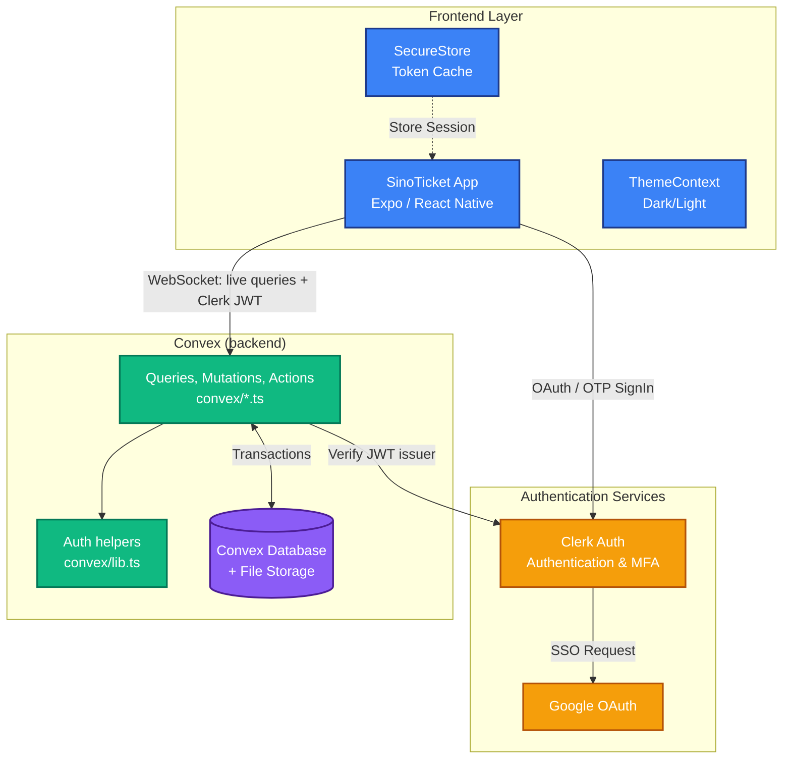
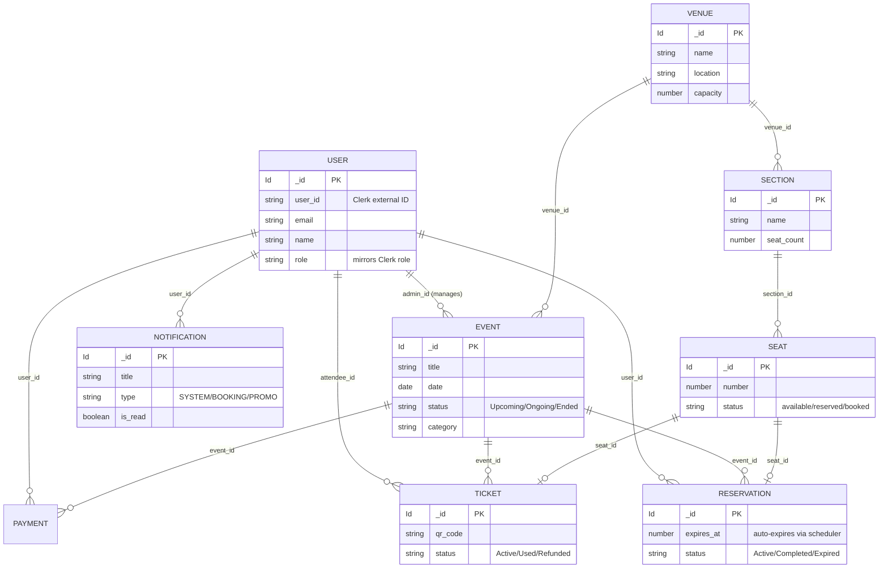

# SinoTicket — Architecture & Implementation Guide

> **Version:** 1.0 | **Stack:** Expo · Convex · Clerk  
> **Last updated:** November 2026

---

## Table of Contents

1. [Project Overview](#1-project-overview)
2. [Repository Structure](#2-repository-structure)
3. [Technology Stack](#3-technology-stack)
4. [Frontend Architecture](#4-frontend-architecture)
   - 4.1 [Expo Router Navigation](#41-expo-router-navigation)
   - 4.2 [Authentication Flow](#42-authentication-flow)
   - 4.3 [Theme System](#43-theme-system)
   - 4.4 [Data Fetching Layer](#44-data-fetching-layer)
   - 4.5 [Screen Reference](#45-screen-reference)
   - 4.6 [Component Library](#46-component-library)
   - 4.7 [Native Tab Bar](#47-native-tab-bar)
5. [Backend Architecture](#5-backend-architecture)
   - 5.1 [Convex](#51-convex)
   - 5.2 [Data Models](#52-data-models)
   - 5.3 [Functions](#53-functions)
   - 5.4 [Authentication & Roles](#54-authentication--roles)
6. [Booking Flow (End-to-End)](#6-booking-flow-end-to-end)
7. [Environment Variables](#7-environment-variables)
8. [Skills & Agent Setup](#8-skills--agent-setup)
9. [Known Patterns & Conventions](#9-known-patterns--conventions)

---

## 1. Project Overview

**SinoTicket** is a cross-platform mobile ticketing application targeting events in Chad (and beyond). It lets users:

- Browse and search upcoming events by title, date, and category
- View event details with rich media, description, and venue info
- Select ticket categories and specific seats
- Checkout and receive a digital ticket with a QR code
- Manage their ticket wallet directly in the app

The system is split into two codebases inside a single monorepo:

| Layer | Directory | Tech |
|---|---|---|
| Mobile App | `/` (root) | Expo / React Native |
| Backend | `/convex` | Convex (database, functions, file storage, scheduling) |
| Admin Dashboard | `/admin-dashboard` | (Separate app) |

### System Architecture



---

## 2. Repository Structure

```
SinoTicket/
├── app/                        # Expo Router file-based routing
│   ├── _layout.tsx             # Root layout (Clerk + ThemeProvider + fonts)
│   ├── index.tsx               # Entry redirect
│   ├── oauth-native-callback.tsx
│   ├── (auth)/                 # Unauthenticated screens
│   │   ├── _layout.tsx
│   │   ├── welcome.tsx
│   │   ├── onboarding.tsx
│   │   ├── sign-in.tsx
│   │   ├── sign-up.tsx
│   │   ├── sign-up-phone.tsx
│   │   └── forgot-password.tsx
│   └── (root)/                 # Authenticated screens
│       ├── _layout.tsx
│       ├── checkout.tsx
│       ├── seat-selection.tsx
│       ├── success.tsx
│       ├── notifications.tsx   # In-app notifications inbox
│       ├── event/[id].tsx      # Dynamic event detail page
│       └── (tabs)/             # Bottom tab bar screens
│           ├── _layout.tsx     # NativeTabs definition
│           ├── home.tsx
│           ├── ticket.tsx
│           ├── history.tsx
│           └── profile.tsx
├── components/                 # Shared UI components
│   ├── Booking/                # Booking-specific components
│   │   ├── QuantitySelector.tsx
│   │   ├── SummaryBar.tsx
│   │   └── TicketCategoryCard.tsx
│   ├── CustomButton.tsx
│   ├── InputField.tsx
│   ├── LoadingScreen.tsx
│   └── PromoCarousel.tsx
├── constants/
│   └── colors.ts               # Centralized theme color tokens
├── context/
│   └── ThemeContext.tsx        # ThemeProvider + useTheme hook
├── hooks/
│   ├── useSocialAuth.ts        # Google OAuth via Clerk
│   └── useWarmUpBrowser.ts    # Expo WebBrowser pre-warming
├── lib/
│   ├── auth.ts                 # Clerk token cache (SecureStore)
│   └── convex.ts               # Convex client + useLiveQuery / useApiMutation
├── convex/
│   ├── schema.ts               # Tables + indexes
│   ├── auth.config.ts          # Clerk as the JWT issuer
│   ├── lib.ts                  # Auth helpers (requireUser, requireAdmin, ...)
│   ├── events.ts venues.ts sections.ts seats.ts
│   ├── reservations.ts tickets.ts
│   ├── users.ts notifications.ts dashboard.ts files.ts
│   ├── push.ts                 # Expo push notifications (action)
│   ├── crons.ts                # Hourly "mark past events as ended"
│   └── seed.ts                 # Demo data
└── .agents/skills/             # AI agent skill files (Expo skills)
```

---

## 3. Technology Stack

### Frontend
| Package | Version | Purpose |
|---|---|---|
| `expo` | ~54.0 | Cross-platform runtime |
| `expo-router` | ~6.0 | File-based navigation |
| `expo-blur` | ~15.0 | Glassmorphism BlurView |
| `expo-linear-gradient` | latest | Image gradient overlays |
| `expo-auth-session` | ~7.0 | OAuth redirect handling |
| `@clerk/expo` | ^3.1 | Authentication provider |
| `react-native-reanimated` | ~4.1 | Animations and transitions |
| `react-native-safe-area-context` | ~5.6 | Safe area insets |
| `nativewind` / `tailwindcss` | 4.x / 3.x | Utility CSS classes |
| `@expo/vector-icons` | ^15 | Ionicons, MaterialIcons |
| `expo-secure-store` | ~15.0 | Persistent secure storage |
| `expo-image-picker` | ~16.0 | Device photo library access |

### Backend
| Package | Version | Purpose |
|---|---|---|
| `convex` | ^1.50 | Database, server functions, file storage, scheduler, React client |

---

## 4. Frontend Architecture

### 4.1 Expo Router Navigation

The app uses **file-based routing** via Expo Router. The navigation tree:

```
/                      → index.tsx (redirects based on auth)
/(auth)/...            → Sign-in, Sign-up, Onboarding, Forgot PW
/(root)/(tabs)/home    → Home feed
/(root)/(tabs)/ticket  → My Wallet
/(root)/(tabs)/history → History
/(root)/(tabs)/profile → Profile
/(root)/personal-info  → Manage personal profile + avatar
/(root)/event/[id]     → Event detail (dynamic)
/(root)/seat-selection → Seat picker
/(root)/checkout       → Checkout
/(root)/success        → Booking confirmation
```

**Root layout (`app/_layout.tsx`)** wraps everything in:
```
ThemeProvider
  └── ClerkProvider (+ tokenCache using SecureStore)
        └── ConvexProviderWithClerk (sends the Clerk session to Convex)
              ├── SplashManager
              ├── UserSync (creates/refreshes the user's Convex row after sign-in)
              └── GlobalErrorBoundary
                    └── AppShell (Stack navigator + StatusBar)
```

### 4.2 Authentication Flow

Authentication uses **Clerk** with the `@clerk/expo` SDK.

**Sign-up:** Email + password → email verification OTP → session set → `UserSync` creates the user in Convex  
**Sign-in:** Email/password or Google OAuth → session set via `setActive()`  
**MFA:** If the account requires second-factor, the app sends an email code and verifies it

**Google OAuth** is handled via `useSocialAuth` hook:
```ts
const { createdSessionId, setActive } = await startSSOFlow({ strategy: "oauth_google", redirectUrl });
if (createdSessionId) await setActive({ session: createdSessionId });
// UserSync then calls users.store to create/refresh the Convex user row
```

Sessions are cached with `expo-secure-store` via `lib/auth.ts`:
```ts
export const tokenCache = {
  getToken: (key) => SecureStore.getItemAsync(key),
  saveToken: (key, value) => SecureStore.setItemAsync(key, value),
}
```

After successful auth, users are navigated to `/(root)/(tabs)/home`.

### 4.3 Theme System

The app has a full **dark/light mode** system persisted across launches.

**`constants/colors.ts`** — Central color palette:

| Token | Light | Dark | Usage |
|---|---|---|---|
| `background` | `#FFFFFF` | `#0F172A` | Screen backgrounds |
| `card` | `#F8FAFC` | `#1E293B` | Cards, modals |
| `text` | `#0F172A` | `#F1F5F9` | Primary text |
| `subtext` | `#64748B` | `#94A3B8` | Secondary text |
| `primary` | `#0286FF` | `#0286FF` | CTA buttons, icons |
| `primaryLight` | `rgba(2,134,255,0.10)` | `rgba(2,134,255,0.18)` | Soft tinted backgrounds |
| `seatAvailable` | `#E2E8F0` | `#334155` | Seat map |
| `seatSelected` | `#0286FF` | `#0286FF` | Selected seat |
| `seatBooked` | `#EF4444` | `#DC2626` | Taken seat |

**`context/ThemeContext.tsx`** — React context providing `colors`, `theme`, `isDark`, and `toggleTheme()`.

The theme is **persisted** via `SecureStore` under the key `sinoticket_theme`. On first load, it defaults to the OS appearance via `useColorScheme()`.

Usage in any component:
```ts
const { colors, isDark } = useTheme();
```

### 4.4 Data Fetching Layer

**`lib/convex.ts`** wraps the Convex React client:

| Export | Description |
|---|---|
| `convex` | The shared `ConvexReactClient` (reads `EXPO_PUBLIC_CONVEX_URL`). Use `convex.query(...)` / `convex.mutation(...)` for one-off calls |
| `api` | Typed references to the backend functions, e.g. `api.events.list` |
| `useLiveQuery(ref, args, options?)` | Live query with an offline cache. Returns `{ data, loading, error, isOffline, refetch }`; `data` updates by itself when the database changes. `{ authenticated: true }` waits for the Clerk session |
| `useApiMutation(ref)` / `useApiAction(ref)` | Like `useMutation` / `useAction`, but errors carry a clean message for `Alert.alert` |
| `errorMessage(err)` | Extracts the readable message from a Convex error |

Example (public, live):
```ts
const { data, loading } = useLiveQuery(api.events.list, { limit: 20, page: 1 });
```

Example (signed-in user):
```ts
const { data } = useLiveQuery(api.tickets.mine, {}, { authenticated: true });
const checkout = useApiMutation(api.tickets.checkout);
await checkout({ reservation_id, payment_method: "Card" });
```

`app/_layout.tsx` wraps the app in `ConvexProviderWithClerk`, and `components/UserSync.tsx` creates/refreshes the user's row in Convex after sign-in.

**Search debouncing** is done at the component level on the Home screen with a 500ms timeout.

### 4.5 Screen Reference

#### Home (`/(tabs)/home.tsx`)
- Live query `api.events.list` with `search`, `category`, `page`, `limit`
- Shows promo carousel (`PromoCarousel`) for "All" category with no search
- **Featured events**: top 3 as horizontal snap scroll cards (260x320, full bleed image)
- **More Events**: remaining events as vertical list rows with image thumbnail and metadata

#### Event Detail (`/(root)/event/[id].tsx`)
- Live query `api.events.get`
- **Hero Section**: full-width image, `LinearGradient` fade into theme background color
- **Back + Share** buttons: circular `BlurView` glassmorphic overlays at top
- **Date Badge**: `BlurView` card overlaid on image bottom-right
- **Info Row**: Shows start time. Inline **Tickets Pricing** block displays immediately below.
- **Description** + **Location** map placeholder image
- **Floating CTA**: absolute bottom bar with `LinearGradient` + green "Book Now" pill
- Tap "Book Now" → bottom-sheet modal for ticket category + quantity selection, then → `seat-selection`

#### Ticket Wallet (`/(tabs)/ticket.tsx`)
- Live query `api.tickets.mine` (signed-in), cached offline under `active_tickets`
- Shows active tickets for upcoming events; each expands to a QR code containing the ticket code
- Tickets can be downloaded as an image (`DownloadableTicket`)

#### History (`/(tabs)/history.tsx`)
- `api.tickets.mine`, all tickets newest first, pull-to-refresh

#### Notifications (`/(root)/notifications.tsx`)
- Accessed via the bell icon in `AppHeader` (live unread count from `api.notifications.unreadCount`)
- Loads `api.notifications.list`; marks read with `notifications.markRead` / `markAllRead`
- Optimistic UI updates for "Mark as Read" and "Mark All as Read"

#### Seat Selection (`/(root)/seat-selection.tsx`)
- Receives params: `event_id`, `section_id`, `event_title`, `category_name`, initial `quantity` and `price`
- Live query `api.seats.list` with `event_id`: seats turn reserved/booked on every phone as soon as someone else holds or buys them
- Supports selection of up to 10 seats; pre-selects seats the user already holds (`api.reservations.mine`)
- "Continue" calls `reservations.reserve` for each seat (15-minute hold), then → `/checkout`

#### Checkout (`/(root)/checkout.tsx`)
- Displays order summary and payment method (Mobile Money / Card, simulated)
- Calls `tickets.checkout` for each reservation: records the payment, issues the ticket + QR code, sends a notification
- On success → `/success` screen

#### Scanner (`/(root)/scanner.tsx`) — admins only
- Reads a ticket QR code with the camera and calls `tickets.verify`, which marks the ticket `Used`

#### Personal Information (`/(root)/personal-info.tsx`)
- Manages user's name, phone number, and avatar image
- Name and avatar are saved to Clerk (`user.update`, `user.setProfileImage`); name, phone and the avatar URL are saved to Convex with `users.update`
- `AppHeader` and `Profile` read `api.users.me` live, so changes show everywhere immediately

### 4.6 Component Library

| Component | Location | Purpose |
|---|---|---|
| `InputField` | `components/InputField.tsx` | Styled text input with icon and label |
| `CustomButton` | `components/CustomButton.tsx` | Themed pressable button with loading state |
| `PromoCarousel` | `components/PromoCarousel.tsx` | Auto-scrolling banner carousel on Home |
| `LoadingScreen` | `components/LoadingScreen.tsx` | Full-screen loading indicator |
| `TicketCategoryCard` | `components/Booking/TicketCategoryCard.tsx` | Selectable ticket tier card in modal |
| `QuantitySelector` | `components/Booking/QuantitySelector.tsx` | Increment/decrement quantity row |
| `SummaryBar` | `components/Booking/SummaryBar.tsx` | Sticky bottom bar with price + CTA button |

### 4.7 Native Tab Bar

The tab bar uses **`expo-router/unstable-native-tabs`** (`NativeTabs`) — a platform-native implementation:
- **iOS**: uses `UITabBar` with SF Symbols
- **Android**: uses Material Design bottom navigation with `MaterialIcons` via `VectorIcon`

```tsx
import { NativeTabs, Icon, Label, VectorIcon } from 'expo-router/unstable-native-tabs';
import { MaterialIcons } from '@expo/vector-icons';

<NativeTabs>
  <NativeTabs.Trigger name="home">
    <Icon sf="house" androidSrc={<VectorIcon family={MaterialIcons} name="home" />} />
    <Label>Home</Label>
  </NativeTabs.Trigger>
  // ... ticket, history, profile
</NativeTabs>
```

> Note: `Icon` and `Label` are imported directly from `expo-router/unstable-native-tabs`, NOT as properties of `NativeTabs.Trigger`. The `md="..."` prop is not supported; use `androidSrc` with `VectorIcon` instead.

---

## 5. Backend Architecture

### 5.1 Convex

There is no server to run or deploy by hand. The backend is the set of functions in `/convex`, hosted by Convex:

- **Queries** read data and are live: clients re-render when results change.
- **Mutations** write data. Each one is a serializable transaction, which is what prevents two people from booking the same seat.
- **Actions** talk to the outside world (Expo push, Clerk API) and run long batch jobs (bulk seat generation).
- **Scheduler / crons** release expired seat holds and mark past events as ended.
- **File storage** holds event images uploaded from the admin dashboard.

`npx convex dev` pushes changes to your dev deployment as you save; `npx convex deploy` ships to production.

### 5.2 Data Models

All tables are defined in `convex/schema.ts`. Convex adds `_id` and `_creationTime` to every document; functions also return `createdAt`/`updatedAt` ISO strings for the UIs. Below is the Entity Relationship Diagram showing how these documents interconnect:



#### User
```js
{ user_id, email, name, profile_photo, phone_number,
  role, preferences, is_verified, push_tokens, last_login }
```
> `user_id` is the Clerk user ID. `role` mirrors Clerk's `publicMetadata.role` and is refreshed on every sign-in.

#### Event
```js
{ title, description, imageUrl, date, venue_id (->Venue),
  admin_id (->User), status: ['Upcoming','Ongoing','Ended'],
  category: ['Music','Sports','Cultural','Business','Fashion'],
  artist_lineup: [{ name, time }],
  ticket_categories: [{ category_id, name, price, section_id, quantity, sold }] }
```

#### Venue
```js
{ name, location, capacity, admin_id (->User), map_data }
```

#### Section
```js
{ venue_id (->Venue), name, description, parent_section_id (->Section), seat_count }
```

#### Seat
```js
{ section_id (->Section), number, status: ['available','reserved','booked'] }
```
> Per-event availability is computed by `seats.list` from tickets and active reservations; the stored `status` is only an admin override.
```js
```

#### Reservation *(auto-expiring)*
```js
{ user_id, event_id, seat_id, expires_at, status: ['Active','Expired','Completed'] }
```
> `reservations.reserve` schedules `reservations.expire` at `expires_at`, which marks the hold `Expired` and frees the seat.

#### Ticket
```js
{ event_id, category_id, attendee_id, seat_id, qr_code, status: ['Active','Used','Refunded'] }
```

#### Payment
```js
{ user_id, event_id, amount, currency, status: ['Pending','Success','Failed'],
  payment_method: ['MobileMoney','Card'], transaction_id }
```

#### Notification
```js
{ user_id, title, message, type: ['SYSTEM','BOOKING','PROMO'], is_read, link }
```

### 5.3 Functions

| Function | Type | Auth | Description |
|---|---|---|---|
| `events.list` | query | Public | List/search events (`search`, `category`, `status`, `page`, `limit`, `all`) |
| `events.get` | query | Public | Single event with venue |
| `events.add` / `update` / `remove` | mutation | Admin | Manage events |
| `venues.list` | query | Public | List venues |
| `venues.add` / `update` / `remove` | mutation | Admin | Manage venues |
| `sections.list` / `get` | query | Public | List sections |
| `sections.add` / `update` / `remove` | mutation | Venue owner | Manage sections (remove cascades to sub-sections and seats) |
| `seats.list` | query | Public | Seats of a section; with `event_id`, live per-event status |
| `seats.generate` / `clearSection` | action | Venue owner | Bulk create / delete seats |
| `seats.update` / `remove` | mutation | Venue owner | Edit a seat |
| `reservations.reserve` | mutation | User | Hold a seat for 15 minutes |
| `reservations.cancel` | mutation | User | Release holds |
| `reservations.mine` | query | User | Current holds |
| `tickets.checkout` | mutation | User | Turn a hold into a ticket (simulated payment) |
| `tickets.mine` | query | User | Current user's tickets |
| `tickets.verify` | mutation | Admin | Scanner: validate a QR code and mark the ticket used |
| `tickets.listAll` | query | Admin | All tickets |
| `users.me` / `store` / `update` | query / mutation | User | Profile; `store` syncs the Clerk user after sign-in |
| `users.checkExists` | query | Public | Is this email registered? |
| `users.list` | query | Admin | All users |
| `notifications.list` / `unreadCount` | query | User | In-app notifications |
| `notifications.markRead` / `markAllRead` | mutation | User | Mark as read |
| `dashboard.stats` | query | Admin | Dashboard totals and revenue chart |
| `files.generateUploadUrl` / `getUrl` | mutation | Admin | Event image upload |

Browse and run them in the Convex dashboard (`npx convex dashboard`).

### 5.4 Authentication & Roles

Clerk signs users in and issues JWTs; Convex verifies them (`convex/auth.config.ts`, issuer = `CLERK_JWT_ISSUER_DOMAIN`). Inside a function, `ctx.auth.getUserIdentity()` returns the caller. The helpers in `convex/lib.ts` build on that:

- `requireUser(ctx)` — signed-in user (row created on first use)
- `requireAdmin(ctx)` — user whose role is `admin`
- `requireVenueOwner(ctx, venueId)` — admin who owns that venue

The admin role lives in Clerk (`publicMetadata.role = "Admin"`). On every sign-in Convex copies it into `users.role` using `CLERK_SECRET_KEY`. Without that key, grant it by hand: `npx convex run users:setRole '{"email":"...","role":"admin"}'`.

---

## 6. Booking Flow (End-to-End)

Seat holds and purchases are Convex mutations, which run as serializable transactions, so two people can never hold or buy the same seat.

```mermaid
sequenceDiagram
    participant User
    participant App
    participant Auth as Clerk
    participant Convex as Convex functions
    participant DB as Convex DB

    User->>App: Opens event detail
    App->>Convex: events.get (live query)
    Convex-->>App: Event data
    User->>App: Taps "Book Now" & picks a category
    App->>Convex: seats.list(section_id, event_id) (live query)
    Convex-->>App: Seats with per-event status (updates live)
    User->>App: Selects seats, taps Continue

    Note over App,Auth: Signed-in users only (the (root) stack requires a Clerk session)
    App->>Auth: Get session token
    Auth-->>App: JWT (sent to Convex automatically)

    App->>Convex: reservations.reserve (one per seat)
    Convex->>DB: Create hold (15 min) + schedule reservations.expire
    Convex-->>App: Reservation IDs

    User->>App: Chooses payment method, taps Pay
    App->>Convex: tickets.checkout (one per reservation)
    Convex->>DB: Payment + Ticket (QR code), hold → Completed, sold count +1
    Convex->>DB: Booking notification
    Convex-->>App: Ticket
    Convex-)User: Expo push notification (scheduled action)

    App->>User: Success screen; wallet updates live
```

If the user never pays, `reservations.expire` runs at the deadline and the seat becomes available again.

---

## 7. Environment Variables

### Mobile app (`/.env`, `/.env.local`)
```env
EXPO_PUBLIC_CLERK_PUBLISHABLE_KEY=pk_test_...
EXPO_PUBLIC_CONVEX_URL=https://<your-deployment>.convex.cloud   # written by `npx convex dev`
```

### Admin dashboard (`/admin-dashboard/.env`)
```env
VITE_CLERK_PUBLISHABLE_KEY=pk_test_...
VITE_CONVEX_URL=https://<your-deployment>.convex.cloud
```

### Convex deployment (set with `npx convex env set NAME value`)
```env
CLERK_JWT_ISSUER_DOMAIN=https://<your-app>.clerk.accounts.dev   # Clerk "Frontend API URL"
CLERK_SECRET_KEY=sk_test_...                                    # lets Convex read the admin role from Clerk
```

---

## 8. Skills & Agent Setup

The project uses **Expo AI Agent Skills** installed via `npx skills add expo/skills`. All 10 official skills from `https://github.com/expo/skills.git` are installed to `.agents/skills/`:

| Skill | Purpose |
|---|---|
| `building-native-ui` | Complete guide for building Expo Router UIs |
| `expo-api-routes` | API route patterns for EAS Hosting |
| `expo-cicd-workflows` | EAS CI/CD workflow YAML files |
| `expo-deployment` | iOS / Android / Web deployment |
| `expo-dev-client` | Distribution and dev build setup |
| `expo-module` | Writing native Expo modules (Swift/Kotlin) |
| `expo-tailwind-setup` | NativeWind v5 / Tailwind CSS v4 setup |
| `native-data-fetching` | React Query, SWR, fetch patterns |
| `upgrading-expo` | SDK upgrade guide |
| `use-dom` | Expo DOM components (web in native) |

---

## 9. Known Patterns & Conventions

### Styling
- **Expo screens**: inline style objects — no separate StyleSheet file unless complex
- **Auth screens**: mix of NativeWind (`className=`) and inline styles for dynamic theming
- **Colors**: always referenced via `const { colors } = useTheme()` — never hardcoded
- **Typography**: primary font is `Syne_700Bold` loaded via `@expo-google-fonts/syne`

### Navigation
- Use `useRouter()` from `expo-router` for programmatic navigation
- Pass complex params via `router.push({ pathname, params })`
- Deep link paths use the file-system path convention e.g. `/(root)/event/[id]`

### API Calls
- Screens that display data: `useLiveQuery(api.module.fn, args)` (add `{ authenticated: true }` for user data)
- Writes: `useApiMutation(api.module.fn)`
- One-off calls outside hooks: `convex.query(...)` / `convex.mutation(...)`

### Error Handling
- Backend functions fail with `fail("message")` (a `ConvexError`); successful calls just return data
- `useApiMutation` / `errorMessage(err)` give the UI the plain message
- `useLiveQuery` exposes failures as `error` instead of throwing

### Glassmorphism Pattern (Event Detail)
```tsx
<BlurView
  intensity={isDark ? 50 : 80}
  tint={isDark ? "dark" : "light"}
  style={{ borderRadius: 24, overflow: 'hidden' }}
>
  {/* content */}
</BlurView>
```
- `intensity` adapts to dark/light — higher in light mode for visible frosting effect
- Always set `overflow: 'hidden'` on `BlurView` to clip border radius correctly
- For the LinearGradient hero fade: use `isDark ? 'rgba(0,0,0,0.8)' : 'rgba(255,255,255,0.9)'` as the middle stop so it blends naturally into the theme background in both modes

---

*This document is auto-generated and maintained alongside the codebase. Update it when adding new screens, models, or architectural changes.*
