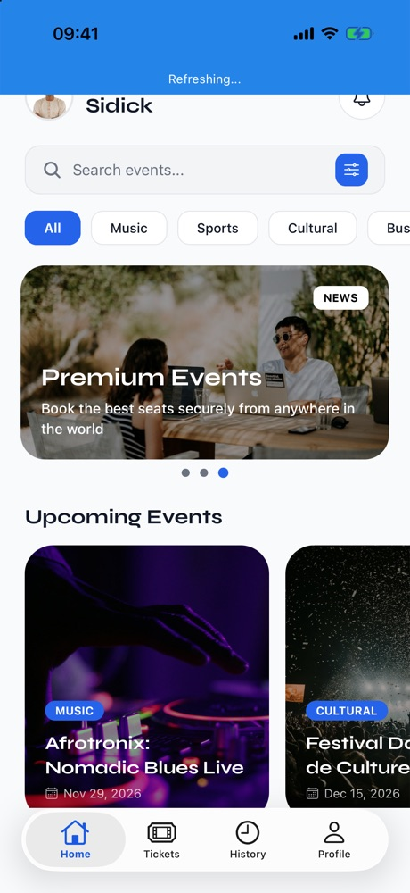
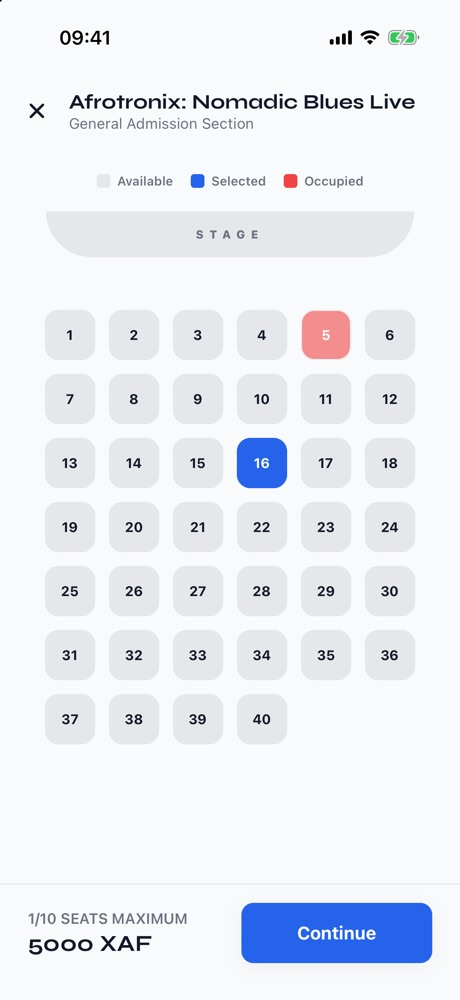
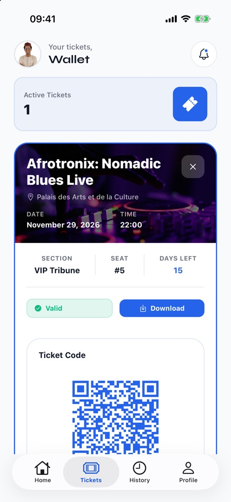
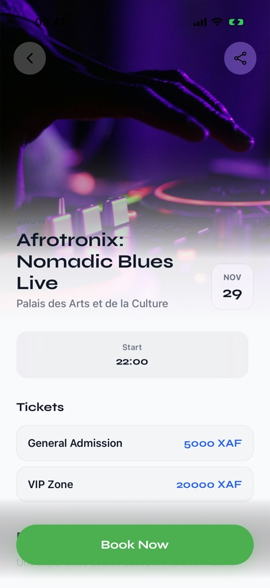
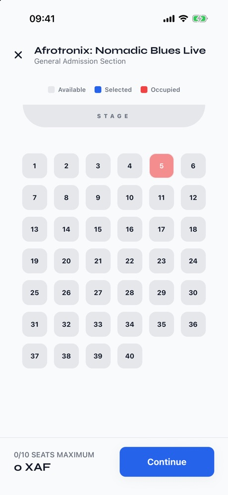
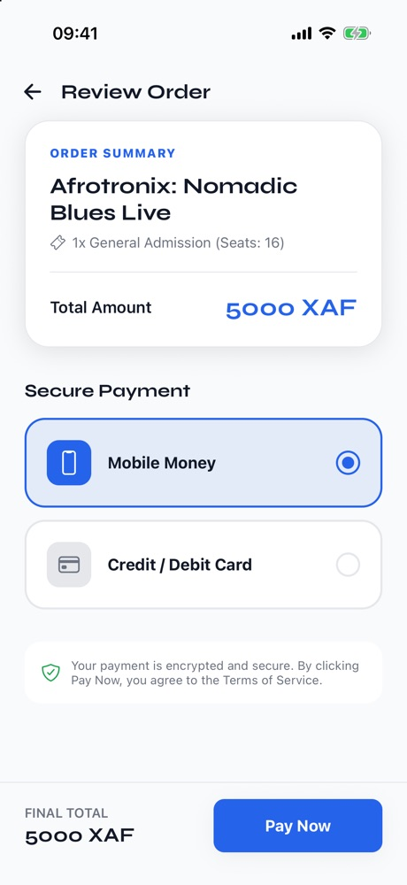
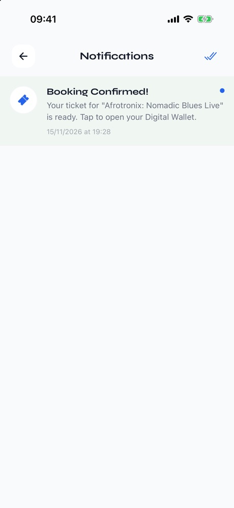
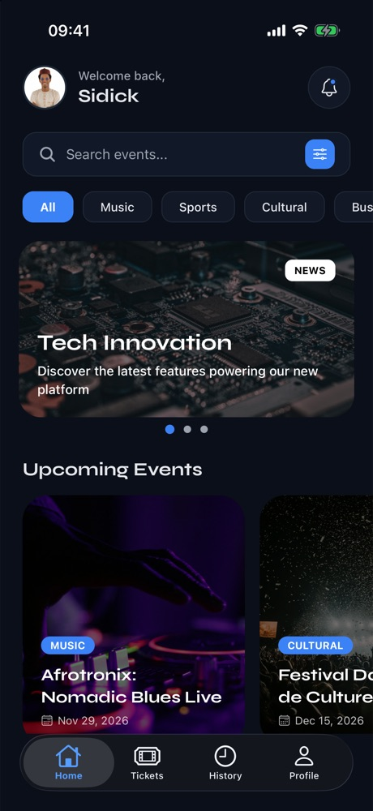
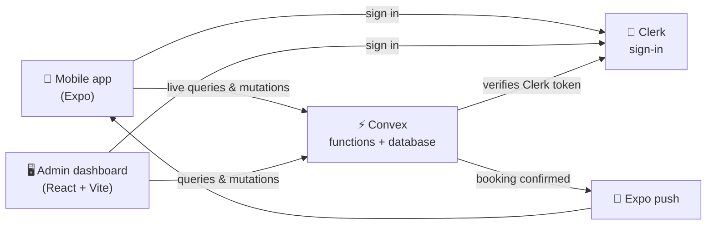

<div align="center">


# SinoTicket

**Event ticketing for Chad: discover events, pick your seat, and keep your ticket on your phone.**


</div>

<p align="center">
  
  &nbsp;
  
  &nbsp;
  
</p>

---

## About

Paper tickets sold at the door mean queues on the day, no way to choose a seat in advance, and tickets that are easy to fake. Organizers also can't see how sales are going until the event starts.

**SinoTicket** puts the whole process on a phone:

- **Attendees** browse upcoming events, choose a ticket category and an exact seat, pay, and get a QR-code ticket in their wallet.
- **Organizers** create venues, sections, seats and events from a web dashboard, follow sales live, and scan tickets at the entrance with the same app.

The app is available in **English and French** and supports **light and dark mode**.

## Features

### For attendees
- **Discover events:** search by name and filter by category (Music, Sports, Cultural, Business, Fashion).
- **Event pages:** artwork, date and time, venue, line-up, and ticket prices in XAF.
- **Live seat map:** seats turn red on every phone the moment someone else holds or buys them.
- **Fair seat holds:** a chosen seat is held for 15 minutes during checkout, then released automatically if unpaid. Two people can never buy the same seat.
- **Checkout:** Mobile Money or card. Payment is simulated for now, so no real money moves.
- **Digital wallet:** each ticket has a unique QR code and can be downloaded as an image.
- **Notifications:** an in-app inbox plus push notifications when a booking is confirmed.
- **Accounts:** email or Google sign-in, profile photo, phone number, language, and theme.

### For organizers (admins)
- **Ticket scanner:** scan a QR code at the door to validate the ticket and mark it as used, so it can't be used twice.
- **Admin dashboard (web):**
  - Revenue, tickets sold, users and events at a glance, with a six-month sales chart.
  - Manage venues, sections (nested), and seats (generate thousands at once).
  - Create and edit events: images, categories, line-up, and ticket categories linked to sections.
  - Browse all tickets and users.

## Screenshots

| Home | Event | Tickets |
|:---:|:---:|:---:|
|  |  |  |
| **Seat map** | **Checkout** | **Wallet & QR code** |
|  |  |  |
| **Notifications** | **Dark mode** | |
|  |  | |

## Tech stack

| Part | Technology |
|---|---|
| Mobile app | [Expo](https://expo.dev) (React Native), Expo Router, TypeScript, NativeWind, Reanimated |
| Backend | [Convex](https://convex.dev): database, server functions, scheduled jobs, file storage |
| Authentication | [Clerk](https://clerk.com): email and Google sign-in, with roles for admins |
| Admin dashboard | React + Vite, Tailwind CSS, Recharts |
| Notifications | Expo push notifications |
| Languages | i18next (English, French) |

## How it works



- **No server to manage.** The backend is a set of TypeScript functions in [`convex/`](convex) hosted by Convex, so there is no idle server that has to wake up.
- **Live by default.** Screens subscribe to queries, and the seat map, wallet and notification badge update on their own when data changes.
- **Safe booking.** Every write runs as a transaction. Holding a seat checks that nobody else holds or owns it, and checking out turns the hold into a ticket and records the payment in one step.
- **Automatic expiry.** Each seat hold schedules its own release 15 minutes later, and an hourly job marks past events as ended.

The full details (data model, every backend function, and the booking sequence) are in **[ARCHITECTURE.md](ARCHITECTURE.md)**.

## Getting started

### Prerequisites
- Node.js 18 or newer
- Xcode with an iOS simulator, or Android Studio
- Free accounts on [Convex](https://convex.dev) and [Clerk](https://clerk.com)

### 1. Install

```bash
git clone https://github.com/sidicksino/SinoTicket.git
cd SinoTicket
npm install
```

### 2. Configure Clerk

Create `.env` in the project root:

```env
EXPO_PUBLIC_CLERK_PUBLISHABLE_KEY=pk_test_...
```

In the Clerk dashboard, go to **Configure → Integrations** and turn on **Convex**.

### 3. Start the backend

```bash
npx convex dev
```

The first run asks you to log in and create (or pick) a Convex project. It writes `EXPO_PUBLIC_CONVEX_URL` to `.env.local`, then keeps your functions in sync as you edit. Leave it running.

Tell Convex about your Clerk app (once per deployment):

```bash
npx convex env set CLERK_JWT_ISSUER_DOMAIN https://<your-app>.clerk.accounts.dev
npx convex env set CLERK_SECRET_KEY sk_test_...
```

Optionally, add demo data (3 venues in N'Djamena, 9 sections, 360 seats, 5 upcoming events):

```bash
npx convex run seed:run
```

> The seed script **deletes** existing venues, sections, seats, events, reservations, tickets and payments first. Don't run it against real data.

### 4. Run the app

Build the development client once:

```bash
npx expo run:ios
```

After that, day to day, you only need:

```bash
npx expo start --dev-client
```

### 5. Admin dashboard (optional)

Create `admin-dashboard/.env`:

```env
VITE_CLERK_PUBLISHABLE_KEY=pk_test_...
VITE_CONVEX_URL=https://<your-deployment>.convex.cloud   # same as EXPO_PUBLIC_CONVEX_URL in .env.local
```

```bash
cd admin-dashboard
npm install
npm run dev
```

Then open http://localhost:5173.

### Making someone an admin

In the Clerk dashboard, open the user and set their **public metadata** to `{ "role": "Admin" }`. The role reaches Convex the next time they sign in. Admins see the ticket scanner in the app's Profile tab and can sign in to the dashboard.

## Project structure

```
SinoTicket/
├── app/                 # Mobile screens (Expo Router)
│   ├── (auth)/          #   onboarding, sign in / sign up
│   └── (root)/          #   tabs, event, seat selection, checkout, scanner…
├── components/          # Shared UI (header, ticket card, booking widgets…)
├── hooks/               # Push notifications, Google sign-in…
├── lib/                 # Convex client helpers, Clerk token cache
├── i18n/                # English / French translations
├── convex/              # Backend: schema + server functions
│   ├── schema.ts        #   tables and indexes
│   ├── reservations.ts  #   15-minute seat holds
│   ├── tickets.ts       #   checkout, wallet, QR verification
│   └── …                #   events, venues, sections, seats, users, dashboard
├── admin-dashboard/     # Web admin panel (React + Vite)
└── docs/screenshots/    # Images used in this README
```

## Deployment

1. **Backend:** run `npx convex deploy` (it creates the production deployment the first time), then connect your production Clerk app with the same `npx convex env set` commands.
2. **Mobile:** build with EAS, setting `EXPO_PUBLIC_CONVEX_URL` and `EXPO_PUBLIC_CLERK_PUBLISHABLE_KEY` in the EAS environment.
3. **Admin dashboard:** deploy `admin-dashboard/` to Vercel, setting `VITE_CONVEX_URL` and `VITE_CLERK_PUBLISHABLE_KEY`.

Everything runs on the free plans of Convex, Clerk and Vercel at the app's current size.

## Roadmap

- [ ] Real Mobile Money (Airtel Money, Moov Money) and card payments
- [ ] Web page for shared event links, for people who don't have the app
- [ ] Refunds and ticket transfers between users
- [ ] Sales reports per event for organizers

## Documentation

- **[ARCHITECTURE.md](ARCHITECTURE.md):** architecture, data model, backend functions, and conventions
- **[MIGRATION.md](MIGRATION.md):** why and how the backend moved from Express/MongoDB on Render to Convex
- **[admin-dashboard/PROJECT_GUIDE.md](admin-dashboard/PROJECT_GUIDE.md):** admin dashboard guide

## Author

Built by **Sidick Abdoulaye Hissein** ([@sidicksino](https://github.com/sidicksino)).
